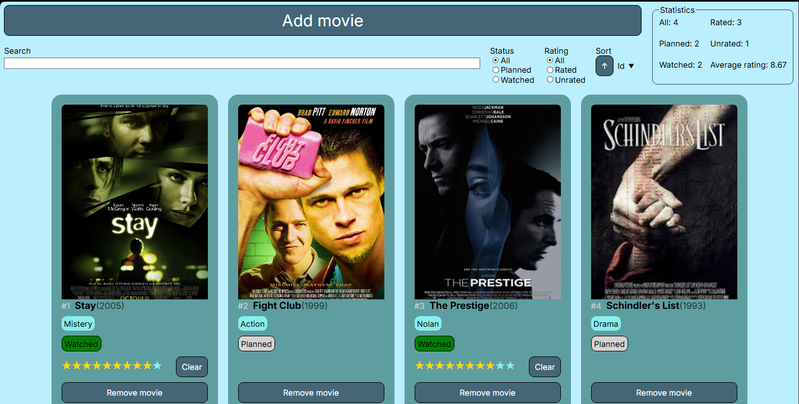

# Cinema

[](LICENSE)
[](https://vuejs.org/)
[](https://www.typescriptlang.org/)
[](https://pinia.vuejs.org/)
[](https://vite.dev/)

[Read in English](README.md)

SPA-коллекция фильмов: отмечай, что планируешь посмотреть, ставь статус «просмотрено», выставляй рейтинг. Ищи фильмы «Звёздных войн» через [SWAPI](https://swapi.dev) и добавляй их в коллекцию. Все данные хранятся в браузере (localStorage) — без бэкенда и аккаунтов.



## Стек

- **Vue 3** — Composition API, компоненты в формате `<script setup>`
- **TypeScript** — типизированные модели, стор и композаблы
- **Pinia** — состояние приложения с сохранением в localStorage
- **Vue Router** — страницы с ленивой загрузкой: список, карточка фильма, поиск
- **Vite** — dev-сервер и продакшен-сборка
- **SWAPI** — данные о фильмах для страницы поиска

## Запуск

Нужен Node 22+.

```bash
npm install
npm run dev      # dev-сервер с HMR
npm run build    # проверка типов + продакшен-сборка в dist/
npm run preview  # локальный просмотр продакшен-сборки
```
